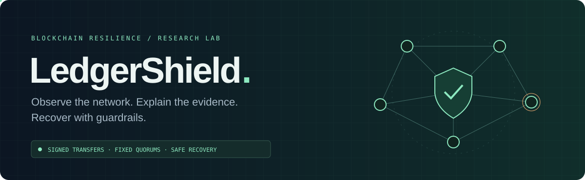
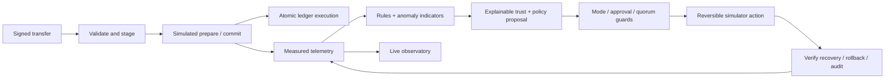
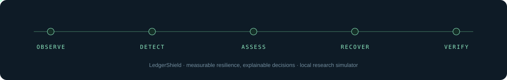

<div align="center">



**A local research platform for explainable blockchain resilience.**

[Overview](#why-ledgershield) · [Run locally](#run-locally) · [API contracts](docs/API.md) · [Experiments](#reproducible-experiments) · [Architecture](docs/architecture.md) · [Validation](docs/VALIDATION.md)


</div>

## Why LedgerShield?

A blockchain network needs more than linked hashes to remain reliable. Transactions must be authenticated, validators must reach agreement, failures must be measured, and recovery decisions need evidence and safety limits.

**LedgerShield** explores that loop in a repeatable local simulator: submit a signed transfer, introduce a node fault, observe its effect on consensus, inspect detection evidence and trust changes, then evaluate a guarded recovery action. A React observatory shows real simulator counters and decisions through FastAPI and WebSockets.

Previously named AutoLedgerAI, this project is an **educational research prototype**. Its centralized simulator is useful for experiments; it is not a formally verified Byzantine protocol or a production financial network. The API uses a rule policy; DQN training and comparison run explicitly offline.

## What is implemented

| Area | Current behavior |
| --- | --- |
| Transactions | Ed25519 signatures, public-key identities, integer amounts, chain IDs, nonces, duplicate/replay checks and atomic balance validation |
| Ledger | Ordered execution, configurable genesis allocations, hash-linked blocks, Merkle roots and full state replay/integrity checking |
| Consensus simulation | Fixed validator membership, signed prepare/commit certificates, `floor(2N/3)+1` quorum, bounded leader replacement and recorded stalls |
| Network faults | Seeded latency/jitter, loss, timeouts, partitions, honest/faulty/unavailable/simulated malicious participants |
| Telemetry | Submission/commit/rejection counts, simulated throughput and latency, propagation, votes, availability, stalls and recovery outcomes |
| Detection | Rule checks, Isolation Forest baseline, severity/confidence, structured evidence and duplicate suppression |
| Trust | Bounded configurable scores, evidence provenance, time decay, duplicate protection and before/after audit records |
| Recovery | Observe-only default, human approval mode, autonomous simulator mode, quorum guards, cooldowns, retries, idempotency and rollback |
| Learning | Seeded Gymnasium environment, no-healing/rule baselines, NumPy DQN with replay/target network, checkpoint save/load and held-out evaluation |
| Dashboard | Reconnecting live stream, node scenarios, signed demo transfers, consensus/metrics, alerts, operating modes and approval journal |

**Durable archive:** configure DATABASE_URL and apply Alembic migration 0001 to retain public snapshots, healing/audit records and completed experiments. Restarts reload experiment listings but initialize a fresh paused simulator. See [setup](docs/setup-guide.md) and [deployment](docs/deployment.md).

**Not yet implemented:** live distributed state persistence/resumption, real peer-to-peer networking, deployment identity management, complete distributed PBFT view changes, automatic DQN deployment, or validated production security. The initial findings are in the [implementation audit](docs/IMPLEMENTATION_AUDIT.md).

**Backend v1:** typed and paginated network/ledger/evidence/recovery APIs, operator/admin authorization, request IDs, structured logs, rate-limited policy evaluation, in-memory experiments and event streams. See the [API contracts and role matrix](docs/API.md).

## Complete research dashboard

Ten connected pages cover Overview, Network Explorer, Blockchain Explorer, Security Center, Trust Management, Self-Healing Center, RL Lab, Simulation Lab, Experiment Reports, and Settings & Audit. Dark/light themes, responsive navigation, role-aware controls, offline/stale states, searchable histories and exact chart data share the live API. See [dashboard behavior and validation](docs/DASHBOARD.md).

Simulation Lab runs bounded failure, latency, partition, suspicious-vote, Sybil-like observer and conflicting-transfer scenarios. Reports compare isolated policies on matched seeds and export actual results as JSON or CSV. RL Lab separates recorded training from checkpoint presence and the rule-based live policy.

## How the resilience loop works



An anomaly is an indicator, not proof of intent. Quarantine requires verified evidence and preserves the original quorum. Missing validators never cause the system to weaken consensus requirements. A recovery is marked successful only after the simulator commits again within its verification budget.

## Run locally

Use **Python 3.12** and **Node.js 24**. All commands start at the repository root unless a different directory is shown. The native dashboard demo needs no database, Kafka, PyTorch or checkpoint. Default Compose includes PostgreSQL for archives.

```bash
git clone https://github.com/manikantbindass/ledgershield-ai.git
cd ledgershield-ai
```

### Windows / PowerShell

```powershell
py -3.12 -m venv .venv
.\.venv\Scripts\python.exe -m pip install -r requirements.lock -r requirements-dev.txt
.\.venv\Scripts\python.exe scripts/create_local_tokens.py

# Terminal 1: local simulator API
.\.venv\Scripts\python.exe -m uvicorn backend.main:app --host 127.0.0.1 --port 8000 --env-file .env

# Terminal 2: dashboard
cd frontend
npm ci
npm run dev -- --port 5173 --strictPort
```

### macOS / Linux

```bash
python3.12 -m venv .venv
.venv/bin/python -m pip install -r requirements.lock -r requirements-dev.txt
.venv/bin/python scripts/create_local_tokens.py
.venv/bin/python -m uvicorn backend.main:app --host 127.0.0.1 --port 8000 --env-file .env

# In another terminal
cd frontend
npm ci
npm run dev -- --port 5173 --strictPort
```

Open the [observatory](http://127.0.0.1:5173), [API documentation](http://127.0.0.1:8000/docs), or [integrity probe](http://127.0.0.1:8000/api/v1/health). Copy your locally generated operator/admin token from the ignored `.env` file into the dashboard password field. It stays only in tab memory. Admin access is required for reset, recovery mode changes and approvals.

The simulator starts paused. **Start simulation** enables one background round every two wall-clock seconds; **Advance round** runs a manual round. Additional viewers do not advance the network. Vite proxies versioned HTTP/WebSocket requests to the API. Settings in [.env.example](.env.example) are optional except the tokens needed for mutations. Empty tokens disable controls. Reset returns to paused observe-only mode; restart starts a fresh paused simulator; configured database archives survive. Keep both services bound to loopback.

### Docker alternative

```bash
docker compose up --build
```

Generate the local `.env` first; Compose passes API tokens to the backend. The same ports are exposed on loopback. Default Compose includes PostgreSQL, migration-gated backend, built non-root nginx frontend, persistent database volumes and readiness checks. Monitoring and Redis are optional profiles. See [deployment](docs/deployment.md) for validated scope and secret handling.

## Try a controlled fault

1. Enter a local API token, then click **Signed demo transfer**, then **Advance round**. Check committed transfers and block height.
2. Set `node_1` to **malicious**. Its wrong-hash signatures become verified invalid-vote evidence. Three honest validators can still commit with a four-validator membership.
3. Review **Evidence & alerts** and **Recovery journal**. Observe-only mode records proposals without intervention.
4. Choose **Human approval required**, reset the scenario or introduce new evidence, and approve a pending proposal before it expires. The quorum guard is rechecked at execution.
5. To explore a stall, set two validators to **unavailable**. Consensus must stall rather than reduce quorum. Restore a validator to **honest**, then advance a round.

Transport settings and partitions are available through `/api/v1/simulation/reset` and `/api/v1/simulation/partition`. Recovery approval requires a proposal generated while approval mode is active; old observe-only proposals are not retroactively executed. All autonomous disruptive actions stay inside this simulator.

## Signed transaction example

The demo wallet uses public, reproducible simulator keys and a fixed genesis allocation. **Never use those keys for real funds.** External transactions need their own funded genesis account and valid signatures.

```python
from ledgershield.core import LedgerState, Transaction, demo_key, public_key

alice = demo_key(42, "alice")  # Simulator identity only
bob = public_key(demo_key(42, "bob"))
ledger = LedgerState({public_key(alice): 100})
tx = Transaction.signed(alice, bob, amount=10, nonce=0)
ledger.submit(tx)  # Validated and staged, not yet committed
```

`POST /api/v1/transactions` accepts `tx.to_dict()`. A mempool acceptance is distinct from a consensus commit. Account balances and sequential nonces prevent conflicting execution in the shared canonical ledger; hash chaining by itself does not prevent double spending.

## Reproducible experiments

From the root, with the virtual environment's Python:

```powershell
# Independent synthetic train/evaluation CSVs and detector confusion counts
.\.venv\Scripts\python.exe scripts/generate_dataset.py

# Explicit offline training, checkpointing and held-out policy comparison
.\.venv\Scripts\python.exe -m ledgershield.learning --episodes 40 --output artifacts/experiment
```

For the extended application-level runner, use `python -m ledgershield.experiments --seeds 22000 22001 22002 --horizon 8 --output artifacts/benchmark` after training. It measures labeled detection/recovery and network outcomes on matched scenarios with sample sizes and exploratory intervals; see [experiment methodology](docs/experiments.md).

The experiment writes `dqn.json` and `experiment.json`, including per-episode rewards, network metrics, seeds, weights and evaluation results. Training uses seeds 100–139; evaluation uses 10000–10011 for identical scenario comparisons across policies. The four toy scenarios are honest, unavailable, malicious and faulty target behavior. The detector fits only normal synthetic training rows at seed 101; evaluation rows use seed 202. Generated datasets and checkpoints are ignored by Git.

The DQN is a small **NumPy** neural network with experience replay and a target network. This keeps the working local path lightweight. Original PyTorch actor/critic code remains an independent historical research helper; it is not advertised as a working PPO implementation. Missing/invalid checkpoints use a safe rule fallback through `load_policy`.

Actual measured comparison and limitations are in [validation results](docs/VALIDATION.md). Training runs do not establish that a policy improves resilience. This phase's measured DQN did **not** beat the no-healing baseline.

## Documentation

[Setup](docs/setup-guide.md) · [SRS](docs/SRS.md) · [Architecture](docs/architecture.md) · [Consensus](docs/consensus.md) · [RL design](docs/rl-design.md) · [Security model](docs/security-model.md) · [Dashboard](docs/DASHBOARD.md) · [API](docs/API.md) · [Testing](docs/testing.md) · [Experiments](docs/experiments.md) · [Deployment](docs/deployment.md) · [Troubleshooting](docs/troubleshooting.md) · [Audit](docs/IMPLEMENTATION_AUDIT.md) · [Roadmap](docs/ROADMAP.md).

## Verification

```powershell
.\.venv\Scripts\python.exe -m pytest -q
.\.venv\Scripts\python.exe -m ruff check backend ledgershield tests migrations
.\.venv\Scripts\python.exe -m ruff format --check backend ledgershield tests migrations
.\.venv\Scripts\python.exe -m mypy
cd frontend
npm run lint
npm run typecheck
npm run format:check
npm test
npm run build
npm audit
```

Tests cover valid/tampered blocks, signatures, replay, duplicate/conflicting transfers, atomic execution, chain state, fixed quorums, failure/partition scenarios, seeded repeatability, certificate phase/view binding, evidence suppression, trust bounds, approvals, rollback, Gymnasium compatibility, DQN updates/checkpoints and API/WebSocket behavior. GitHub Actions runs backend tests plus frontend lint/build.

## Repository map

```text
ledgershield/
  core.py           Signed transactions, blocks, Merkle roots, ledger
  network.py        Seeded transport, validator identities, voting and metrics
  evidence.py       Detection, synthetic features, trust and audit
  recovery.py       Policy proposals, guards, approvals and rollback
  learning.py       Gymnasium environment, DQN and reproducible experiment CLI
  service.py        Telemetry → evidence → trust → recovery integration
backend/main.py     Versioned API, bearer roles, event stream, bounded evaluations
frontend/           React + Vite observatory
blockchain/         Compatibility exports into the canonical implementation
detection-engine/   Original independent anomaly/graph research helpers
trust-system/       Original independent trust research helper
rl-agent/           Historical research code and redirected trainer entry point
scripts/            Dataset generator and legacy HTTP traffic scripts
tests/              Unit and deterministic integration tests
docs/               Audit, architecture, roadmap, validation and SVG animations
```

The legacy traffic scripts are not protocol-level Sybil/double-spend demonstrations; use the dashboard and signed API instead. The [architecture notes](docs/architecture.md) describe state equations, quorum assumptions, observation/action spaces, rewards and simulator limitations.

## Project status and next phase

- Implemented and locally verified: signed ledger, controlled simulator, evidence/trust/recovery pipeline, offline learning experiments and connected observatory.
- Next: durable live-consensus resumption, richer failure experiments, deployment identity management and stronger distributed protocol modeling, according to the [roadmap](docs/ROADMAP.md).
- **Screenshots:** will be captured from the completed local app and added here after the final phase. No mock screenshots are included.

Maintained by [Manikant Kumar](https://github.com/manikantbindass). See [contribution guidance](CONTRIBUTING.md).

## License

A license file has not yet been selected; this README does not grant an MIT license.


