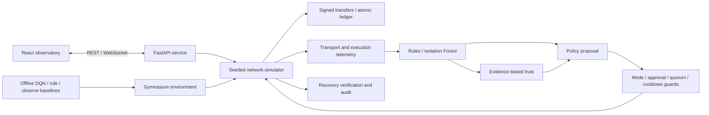

# Architecture and protocol assumptions

## Ledger

Canonical JSON uses sorted keys, ASCII escaping, no whitespace or non-finite numbers. Ed25519 signs the transaction payload including chain ID, sender, receiver, integer amount and nonce. Transaction IDs hash the payload and signature. Addresses are 32-byte public-key hex strings. Amounts use integer smallest units, never floating-point currency. Nonces start at zero; signature validity is checked separately from balance/nonce execution.

Mempool insertion replays pending transactions in insertion order. Block validation stages the entire batch in copied state; one invalid transfer rejects the block without changing balances. This shared state prevents conflicting transfers within the simulated canonical ledger. Hash chaining alone does not prevent double spending.

Block hashes commit to height, parent, ordered transactions, Merkle root, proposer ID, simulated timestamp, chain ID and genesis configuration hash. Merkle leaves are raw SHA-256 transaction IDs; odd leaves duplicate before hashing raw concatenated children. Empty root is SHA-256 of empty bytes. Genesis commits to allocations, chain ID and timestamp. Integrity verification reconstructs state from genesis. `LedgerState.add_block` is the execution gate: production callers must separately enforce consensus acceptance.

## Consensus and transport

The simulator has one canonical ledger and a fixed configured validator membership. Quorum is `floor(2N/3)+1`; it never shrinks for missing or quarantined nodes. With N=4, three valid votes are required. Standard quorum intersection motivates support for at most `floor((N-1)/3)` faulty validators under favorable delivery. This is not a proof of formal Byzantine fault tolerance.

Each simulated round constructs a valid proposal, gathers Ed25519 prepare signatures, then commit signatures bound to chain ID, block height/hash, phase and view. Invalid signatures, outsiders and wrong phases/views do not count. Faulty nodes abstain; unavailable nodes cannot deliver; simulated malicious voters sign an incorrect hash. Failed leaders are skipped, failed rounds advance view, and bounded attempts record a stall. Partitions, configurable latency/jitter, independent message loss and timeouts affect delivery. Commit propagation updates observer heights only on successful delivery.

Limitations: centralized event ordering, global state validation, no independent replica state machines, no adversarial equivocation scheduler, durable locks, signed view-change certificates or real sockets between nodes. Leader replacement is a deterministic simulator operation, not full PBFT view change. Honest agreement and ledger safety rely on this centralized model. Transport delays and throughput are simulated quantities, not hardware benchmarks. Snapshots restore RNG, network, ledger and metrics in memory; they are not durable backups.

## Telemetry and evidence

Metrics count submissions, accepted/rejected input, committed transfers, blocks, delivered/lost/timed-out messages, signed votes, invalid votes, stalls and view changes. Delays come from configured simulated message delivery and round timing. Per-node attempts/votes support participation and consistency. Alerts include simulated tick, participant, method, severity, confidence, normalized features and raw evidence. Confidence values are configured heuristics, not calibrated probabilities.

Isolation Forest trains only on normal labeled synthetic data at seed 101. Evaluation uses a separate generator seed 202; no evaluation rows enter fitting. Features are invalid-vote fraction, timeout fraction and normalized latest delivered latency. Rules flag invalid signed votes and repeated timeouts. Alerts suppress identical evidence as well as rapid duplicates. Model anomalies are unverified indicators and cannot authorize quarantine. A malicious leader skipped before voting need not produce a signed-violation alert; its consensus effects remain measurable.

Trust follows `decayed = initial + (previous-initial)*(1-decay)^elapsed_ticks`, then `score = clamp(decayed + weight[kind]*confidence, minimum, maximum)`. Defaults: initial 80, bounds 0–100, advisory threshold 40, decay .01, verified violation -15, timeout -1, unverified indicator -.5, participation/valid transaction +.2, verified recovery +1. All changes log evidence ID, provenance, before/after and confidence. Duplicate node/evidence pairs are ignored. Forged transaction signatures are never attributed as wrongdoing to the claimed sender. Scores advise policy; they do not ban nodes or change quorum. All weights/thresholds are Python config dataclasses; API operating mode and simulation transport are configurable through validated inputs.

## Recovery and learning

Modes: `observe_only` (default), `approval_required`, `autonomous_simulation`. Permitted actions: observe, monitor, quarantine, restore, resync, recommend reassignment and request view change. No action invokes a shell, modifies credentials, deletes membership or lowers quorum. Quarantine needs verified evidence and enough remaining available validators. Restore rejects known malicious behavior. Resync requires reachability. Membership reassignment remains a recommendation. Disruptive actions verify consensus within a bounded tick budget and restore the snapshot on failure; records retain failure, collateral lagging nodes, attempts, duration and metrics. Keys make requests idempotent; cooldown/retry budgets limit interventions. Pending approvals expire and guards are checked again at execution.

The Gymnasium observation is a clipped 12-vector: availability, target trust, submission acceptance, last consensus progress, normalized latency, target timeout rate, target invalid-vote rate, quarantine flag, monitoring flag, last action/6, elapsed episode fraction and stall rate. Episodes truncate at the horizon. Each step uses the actual simulator, submits a signed transfer, and evaluates allowed recovery. Environment RNG and transport are seeded.

Reward terms are bounded to [0,1]. Defaults: +1 transaction progress, +.3 availability, +.5 consensus progress, -.2 latency, +.5 verified recovery from a non-honest state, -1 intervention on an honest target, -.05 non-observe action, -.5 collateral lag, -.1 recovery duration. The `RewardWeights` dataclass exposes weights. These are research design choices, not a validated economic objective.

The NumPy DQN has a 12→32→7 ReLU network, epsilon-greedy exploration, replay buffer, discounted TD loss with clipped errors and a target network copied every 50 updates. JSON checkpoints validate dimensions, action order and finite values. Invalid/missing models fall back to the rule policy. Training is an explicit CLI workflow; the API never trains, deploys, loads or replaces a policy automatically. The recovery policy interface can accept a configured policy; API operation currently uses the rule policy. The separate DQN experiment uses the same guarded action executor. Neither live online learning nor automatic policy deployment is claimed.

## Operational boundary

API and Vite bind to loopback for local development. Same-origin proxy and origin checks restrict browser requests. Sensitive operations require distinct local operator/admin bearer tokens; public telemetry is read-only. This is not an Internet-facing multi-user identity system. See API.md for roles, limits and sanitized errors. Data, alerts and audits are in memory and reset on restart. PostgreSQL/SQLite archiving and Alembic migrations preserve public research records, while the simulator remains volatile. Kafka, JWT, active Redis integration and encrypted P2P are not implemented. The simulator starts paused, and start/stop controls the single background loop. Optional original PyTorch/NetworkX research helpers remain separate from the canonical runtime. Do not expose this development API to an untrusted network.

## Transactional archive extension

SQLAlchemy and Alembic revision 0001 preserve public research_records in PostgreSQL or optional native SQLite. Batch archive writes use a database transaction and roll back on failure. Experiment listings reload at restart; the simulator itself remains volatile and does not resume from archived snapshots. Readiness includes database/schema checks. The volatile action and subsequent database write are not a distributed transaction; an archive failure is visible, returns 503 and pauses simulation. See deployment.md and security-model.md.
